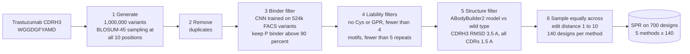
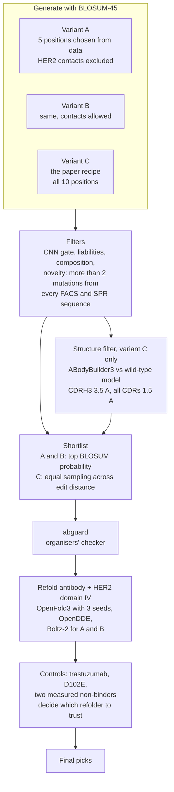

# `moritz` branch: BLOSUM-45 CDRH3 diversification and screening (HER2 / trastuzumab)

How far can a very simple method get us on the optimisation track? We keep trastuzumab's binding mode, change several
residues in its third heavy-chain loop (CDRH3), choose the new residues with the **BLOSUM-45 substitution matrix**
(the method that won in the paper below), and then screen the designs with every independent check we have.

> Paper: Chinery, Hummer, Mehta et al., *Simple computational methods can outperform deep learning in designing
> diverse, binder-enriched antibody libraries*, bioRxiv [10.1101/2024.03.26.586756](https://doi.org/10.1101/2024.03.26.586756).
> In their SPR experiment, about 48% of BLOSUM designs kept measurable binding to HER2, against 11-21% for AbLang,
> ESM-2 and ProteinMPNN, and one BLOSUM design (3 mutations) bound tighter than trastuzumab.

## The 60-second version

1. **The loop.** Of CDRH3's 10 residues (`W99 G100 G101 D102 G103 F104 Y105 A106 M107 D108`), only W99, G103, F104 and
   Y105 touch HER2 in the crystal structure (1N8Z). The rules ask for several changes in this loop.
2. **BLOSUM-45** scores how often evolution swaps one amino acid for another. We turn those scores into swap
   probabilities and sample designs from them: conservative swaps are likely, radical ones rare.
3. **We ran it three ways** (A: positions chosen from data, HER2 contacts excluded; B: the same with contacts allowed;
   C: the paper's recipe as faithfully as possible) and screened every design with the organisers' `abguard`, a
   structure model, and refolding of the antibody-HER2 complex.
4. **Evidence is computational only.** Of the refolding tools, only OpenFold3 (and, partly, OpenDDE's general
   checkpoint) separated known binders from known non-binders, so a recovered binding pose is weak evidence, not proof
   of binding.
5. **The paper's own recipe held up worst under refolding** (variant C: 1 of 13 designs recovers the pose with
   OpenFold3), because it freely changes HER2-contact residues. Variants A and B give 7 and 3 vetted designs.

## 1. The paper's workflow



The paper deliberately used no machine learning to *design* (BLOSUM is a lookup table) and used models only to
*screen*. That is the pattern we follow.

## 2. BLOSUM-45 in plain words

BLOSUM-45 is a 20x20 table of scores `s(a,b)` learned from how often amino acid `a` is replaced by `b` in related
proteins: positive means "swapped more often than chance" (D to E), negative means rare (D to W). The paper turns a
score row into sampling probabilities:

```
P(b | a)  is proportional to  f(b) * exp( 0.25 * s(a,b) )
```

* `a` is the wild-type residue, `b` the replacement, `f(b)` how common `b` is in CDRH3 loops (SAbDab counts).
* `0.25` is the paper's choice (lower than the textbook 0.35) so that keeping the original residue is less dominant.
* Example, D102: the six most likely swaps are Y, G, S, A, R and N.
* Think of `E = -log P` as an energy: the wild type sits in a basin, conservative swaps are neighbouring shallow
  wells, unlikely swaps are ridges. A whole design's energy is the sum over its changed positions.

## 3. What we ran: three variants



| | A | B | C (paper-faithful) |
|---|---|---|---|
| Positions that may change | 2,3,4,8,9 (best 5 non-contact by FACS and SPR evidence) | 2,4,5,8,9 (best 5 of all; G103 enters) | all 10 |
| Substitutions | BLOSUM-45 odds, swaps already measured in the paper dropped | same | BLOSUM-45 sampling, 'stay' included, as in the paper |
| Selection | highest BLOSUM probability, diverse | same | random, equal per edit distance after the filters |
| Structure filter | none, refolding afterwards | none | ABodyBuilder3 loop RMSD vs wild type |
| Edit distances | 4-5 | 4 | 4-10 |
| Designs touching a HER2-contact position | 0 of 24 | 20 of 24 | 13 of 13 |

Differences from the paper in variant C: ABodyBuilder3 instead of ABodyBuilder2; liabilities counted in CDRH3 only
(the rest of the Fv is trastuzumab's own); edit distances 4-10 instead of 1-10 (the hackathon rules need more than 2
mutations from every known CDRH3); the authors' released CNN weights.

## 4. Results

### Funnels

| Step | A | B | C |
|---|---|---|---|
| Generated / enumerated | 14,256 | 14,256 | 1,000,000 |
| After duplicates | | | 955,689 |
| CNN P(binder) above 90% | | | 187,893 |
| Liability, Cys, GPR, repeats | | | 172,544 |
| More than 2 mutations from all FACS/SPR sequences | 1,958 | 4,262 | 84,059 (83,845 at edit distance 4 or more) |
| Gate score 0.9 or more (A, B) | 405 | 760 | |
| Shortlist | 24 | 24 | 28 modelled, 20 pass the structure filter, 13 picked |

Variant C structure filter: ABodyBuilder3 models of 28 designs (4 per edit distance 4-10) against the wild-type model,
thresholds from the paper. 20 of 28 pass: all four at edit distance 4, and 16 of 24 at edit distances 5-10 (the worst
CDRH3 RMSD is 4.6 A).

### abguard (organisers' checker, found on the team VM)

The tool is in the `hackathon` user's uv cache (not on the PATH): newest build `abguard-0.1.0` of 2026-11-11 16:17,
for example `/home/hackathon/.cache/uv/archive-v0/<hash>/bin/abguard`. It calls itself a demo, so it may differ from the
jury's checker. Run it with `abguard team-validate TABLE.csv [--drop] [-o out.csv]` (columns
`sequence_id,kind(vhh|scfv|paired),heavy_sequence,light_sequence,design_description`; use a `.csv` output path).

* Trastuzumab variants (whole-Fv identity 70% or more) need at least 3 CDRH3 mutations from trastuzumab **and** from
  every CDRH3 in its bundled reference (610,109 CDRH3s, including the HER2 FACS and SPR tables); de novo needs 2.
* The PDF's "under 70% CDRH3 identity" test and "any known antibody" comparison are not implemented in this build.
* `abguard novelty-report` ignores the bundled reference (trastuzumab only); use `team-validate`.
* **All final picks of A and B, all 13 designs of C, pass**; trastuzumab, D102E and the two measured non-binders are
  rejected. Distance to the nearest known CDRH3 is the binding constraint, so margins are thin.

### Refolding: which tool can we trust?

Fv + HER2 domain IV, scored against the 1N8Z crystal (epitope within 4 A after aligning the Fv and at least half of
the 42 crystal contact pairs reproduced). Controls: trastuzumab, D102E, two measured non-binders from the paper's SPR data.

| Service | Binders recovered | Non-binders rejected | Verdict |
|---|---|---|---|
| OpenFold3, MSA on (JapanFold), 3 seeds | 2/2 (D102E in 2 of 3 seeds) | 2/2 | trusted |
| Boltz-2 (Nebius), HER2 alignment | 2/2 | 0/2 | not trusted: reproduces the pose for everything |
| OpenDDE antibody-antigen (JapanFold) | 0/2 | 2/2 | not trusted: fails trastuzumab itself (see the variant C note below) |
| OpenDDE general checkpoint (JapanFold, MSA on), run on all three sets, 2 seeds | 4/4 | 3/4 (non-binder `AYWDGNYAMD`: ipTM 0.45 at seed 0, 0.89 and pose recovered at seed 1) | partly trusted: lenient and seed-dependent |

Single-sequence runs fail everywhere, so the MSA is needed.

**Variant C result:** OpenFold3 recovers the crystal pose for only **1 of the 13** paper-faithful designs
(`WYAGTAYGLE`, in all three seeds, but with low confidence: interface PAE 20 A, ipTM 0.15). The OpenDDE general
checkpoint recovers five consistently (`WLGDGFWATT`, `WTGDGWFASD`, `WGYTGSDAWD`, `WGGESSPSYY`, `YGRDPYDYDA`) and
`WYAGTAYGLE` in one of two seeds. The two refolders agree on only `WYAGTAYGLE`, so the paper recipe's designs
(which change 2.6 contact positions on average) hold up far less well under this check than variants A and B.
This does not contradict the paper's 48% retained-binding rate, which was measured by SPR, not by refolding.

The OpenDDE antibody-antigen checkpoint was also run on the variant C set and behaves oddly: it fails both measured
binders (ipTM 0.36, epitope 30 A off) yet "recovers" five designs with ipTM about 0.9 (`WLGDGFWATT`, `WTGDGWFASD`,
`WGYTGSDAWD`, `WGGESSPSYY`, `WYAGTAYGLE`), the same four as the general checkpoint plus `WYAGTAYGLE`. The two OpenDDE
checkpoints share a lineage, so their agreement is not independent evidence, and a model that rejects trastuzumab but
confidently accepts novel sequences is not a trustworthy referee. The `which`/`tier` columns in
`optimization/baseline/outputs/final_shortlist_paper.csv` count this checkpoint ("3 of 3 services" for `WYAGTAYGLE`); read the tier
as "OpenFold3 plus OpenDDE", not as three independent confirmations.

### Final picks

Variants A and B (OpenFold3 recovers the pose in every seed; structure numbering, W99 = CDRH3 position 1). The last
column is the OpenDDE general checkpoint at seeds 0 and 1, shown for information; the rank counts seed 0 only:

| Variant | Rank | CDRH3 | Changes | OpenDDE general (seed 0 / seed 1) |
|---|---|---|---|---|
| A | 1 | `WAYYGFYVMD` | G100A G101Y D102Y A106V | yes / yes |
| A | 2 | `WDYSGFYYMD` | G100D G101Y D102S A106Y | yes / yes |
| A | 3 | `WAYDGFYYVD` | G100A G101Y A106Y M107V | yes / yes |
| A | 4 | `WYAYGFYYMD` | G100Y G101A D102Y A106Y | yes / yes |
| A | 5 | `WYGAGFYYRD` | G100Y D102A A106Y M107R | yes / **no** (ipTM 0.27) |
| A | 6 | `WDADGFYYGD` | G100D G101A A106Y M107G | yes / yes |
| A | 7 | `WYSYGFYARD` | G100Y G101S D102Y M107R | **no / no** (ipTM 0.28 / 0.32) |
| B | 1 | `WDGAAFYYMD` | G100D D102A G103A A106Y | yes / yes |
| B | 2 | `WYGYSFYYMD` | G100Y D102Y G103S A106Y | yes / yes |
| B | 3 | `WYGAGFYYRD` | (same as A 5) | yes / **no** (ipTM 0.27) |

OpenDDE general was run on all three sets. It is the most lenient of the trusted refolders: it recovers the pose for
11 and 10 of the 12 A designs (seed 0 and 1) and 10 and 10 of the 12 B designs, against 7 and 3 that OpenFold3 recovers
in every seed, and it accepts one measured non-binder at seed 1. It is decisive in one place: the two M107R designs are
the only picks it rejects (`WYSYGFYARD` in both seeds, `WYGAGFYYRD` in seed 1). That matches the SPR data, where all
three measured M107 singles lost 40-70 fold affinity, so rank those two last. Without them the A and B shortlists
shrink to five and two designs that pass both refolders.

Variant C (paper recipe; the 13 designs that passed the sequence filters, abguard and the ABodyBuilder3 filter; ABB3 =
CDRH3 RMSD to the wild-type model; OF3 = seeds recovering the pose; OpenDDE = general checkpoint, seeds 0 and 1):

| CDRH3 | Edit distance | ABB3 CDRH3 RMSD (A) | OF3 | OpenDDE |
|---|---|---|---|---|
| `WLGDGFWATT` | 4 | 1.2 | 0/3 | 2/2 |
| `WTGDGWFASD` | 4 | 1.4 | 0/3 | 2/2 |
| `WGGAGAYTTY` | 5 | 0.8 | 0/3 | 0/2 |
| `WGYTGSDAWD` | 5 | 1.9 | 0/3 | 2/2 |
| `HGGAGYAAQS` | 6 | 0.8 | 0/3 | 0/2 |
| `YRGDYFFAYG` | 6 | 1.9 | 0/3 | 0/2 |
| `WGGESSPSYY` | 7 | 1.6 | 0/3 | 2/2 |
| `WVRRAFYNYT` | 7 | 1.7 | 0/3 | 0/2 |
| **`WYAGTAYGLE`** | 8 | 2.6 | **3/3** | 1/2 |
| `YGRDPYDYDA` | 8 | 2.2 | 0/3 | 2/2 |
| `HRARAWAPLD` | 9 | 2.5 | 0/3 | 0/2 |
| `YLDNKRLGVG` | 10 | 2.2 | 0/3 | 0/2 |
| `FPSNDRFNSY` | 10 | 1.8 | 0/3 | 0/2 |

Only `WYAGTAYGLE` (edit distance 8, changes at positions 2,3,4,5,6,8,9,10) meets the OpenFold3 rule used for A and B,
and its confidence is low, so treat variant C as a diversity library rather than a vetted set. The five designs the
OpenDDE general checkpoint accepts are the next candidates if a second opinion is wanted.

## 5. Caveats and open questions

* No lab data. A recovered pose does not show binding; only OpenFold3 passed the control check, and that rests on two
  binders and two non-binders.
* Changing only non-contact positions can at best tie trastuzumab's affinity, and none of the designs addresses
  thermostability. Variant C changes contact residues on purpose (as the paper's designs did) and relies on the
  paper's 48% retained-binding rate.
* M107: all three measured M107 singles in the paper's SPR data (K, T, A) were 40-70 times weaker.
* Developability: the picks carry 4-6 aromatic residues against trastuzumab's 3.
* Ask the organisers: is the jury's abguard identical to the VM build, is the bar 3 or 2 mutations with the database
  distance enforced, is "under 70% CDRH3 identity" enforced, and does an affinity tie count as "comparable"?

## 6. Repository map and how to reproduce

```
optimization/baseline/   scripts, outputs and a technical README (optimization/baseline/README.md)
  common.py structure_tools.py              helpers; comparison with the 1N8Z crystal
  train_eval.py score_cdrh3.py              binding baselines and the gate
  blosum_diversity.py                       variants A and B (--allow-contacts for B)
  paper_pipeline.py paper_structure_filter.py abb3_nebius.sh      variant C
  refold_prepare.py refold_japanfold.py refold_nebius.sh refold_analyze.py refold_consensus.py pick_shortlist.py
  outputs/                                  shortlists, metrics, consensus (suffix _contacts = B, _paper = C)
optimization/nebius-runs/   run records and inputs      optimization/results/   refolded structures and scores (top model per complex)
```

```bash
# from the repository root
uv venv optimization/baseline/.venv --python 3.12 && uv pip install --python optimization/baseline/.venv/bin/python -r optimization/requirements.txt
cd optimization/baseline
.venv/bin/python train_eval.py                                            # classifiers (needs the data below)
.venv/bin/python blosum_diversity.py                                      # variant A
VARIANT=contacts .venv/bin/python blosum_diversity.py --allow-contacts    # variant B
.venv/bin/python paper_pipeline.py                                        # variant C, steps 1-4 and sampling
.venv/bin/python paper_structure_filter.py prepare && bash abb3_nebius.sh && .venv/bin/python paper_structure_filter.py analyze
VARIANT=paper .venv/bin/python refold_prepare.py --top 13                 # then refold_japanfold.py, refold_analyze.py, pick_shortlist.py
```

`VARIANT=<name>` makes every script write `..._<name>` files and folders, so runs never overwrite each other.
JapanFold calls read `JAPANFOLD_API_KEY`; Nebius calls need `NEBIUS_CREDS` and the `nebius-scientific-ai` skill. No keys
are stored in this repository. The shell helpers `baseline/abb3_nebius.sh` and `baseline/refold_nebius.sh` change into `optimization/` themselves, so run them as `bash optimization/baseline/refold_nebius.sh` from anywhere.

**Data (not included, fetch it yourself):**

| Path expected | Source |
|---|---|
| `optimization/data/her2/tz_her2_facs_3classes_524346.csv.zip` (unzip to `optimization/data/her2/facs_extract/`), `optimization/data/her2/trastuzumab_her2_spr_all_768.csv` | hackathon bucket `data/her2-trastuzumab/` |
| `optimization/data/her2/her2_fv_1n8z.cif` | hackathon bucket `rfd4-proteina/docs/Data/12-her2/her2_fv_1n8z.cif` |
| `optimization/data/mehta/{train,val,test}.csv`, `saved_weights.h5`, `shanehsazzadeh_test.csv` | Zenodo 10831512 `data.zip`, folder `clonotype_split/0.7_0.15_0.15` |
| `optimization/data/paper/spr_submitted.csv` | github.com/oxpig/Tz_her2_affinity_and_beyond, `data/spr/` |
